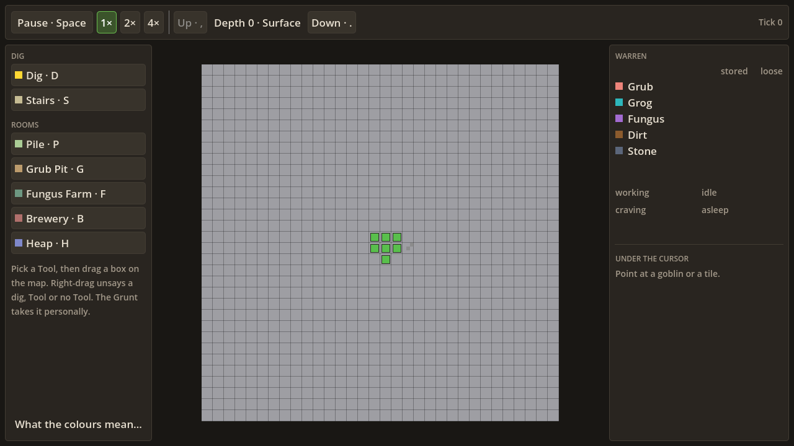
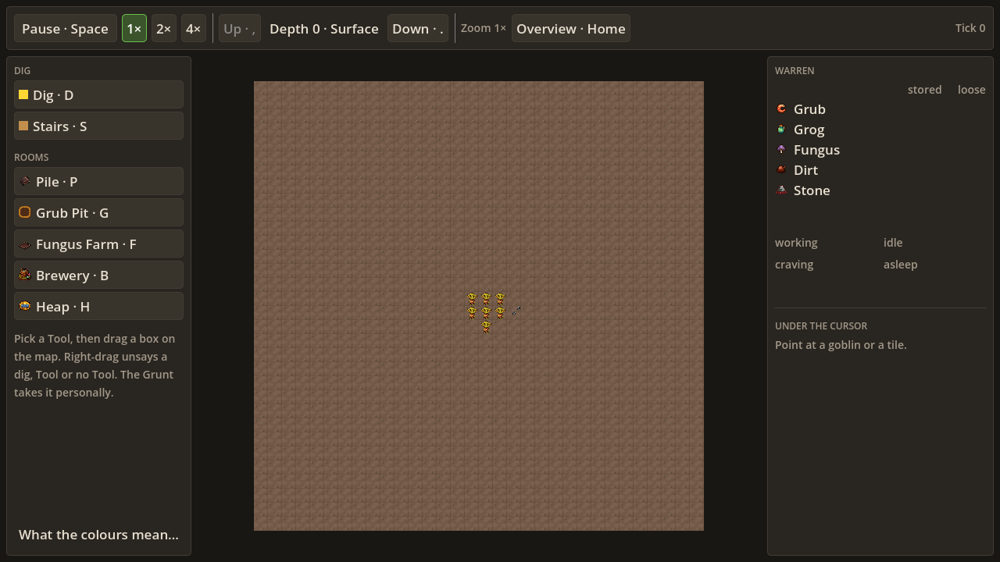
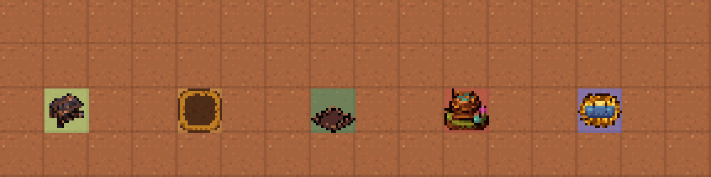

# First pixel-art pass: evidence

This is scripted visual and test evidence, not a new human fun check. P4's historical playtest verdict remains pending in [the checklist](../../playtests/P4-CHECKLIST.md).

## Before and after

The before image uses base commit `678caff` (also `origin/main` when checked). It was built from a temporary `git archive`, leaving the working checkout intact. The after image uses this PR's code and assets. Both capture the actual `Main` scene at tick zero, at 1280×720, with the same fixed starting layout: seven Grunts and the initial Grub/Grog supplies. Main chooses different seeds, but no simulation tick or random wandering runs in either capture.

| Before: grey boxes and swatches | After: shared sprites and close-view controls |
| --- | --- |
|  |  |

`CaptureOverview.gd.txt` is the throwaway capture driver; it is not imported by the game. Copy it to a temporary `.gd` file and use the Godot .NET executable:

```bash
godot-mono --path game --script /tmp/CaptureOverview.gd -- /absolute/path/overview.png
```

The scene's `_Ready` runs, then processing is disabled before a sim tick and the actual viewport is read after layout and drawing. There are no image-generated UI mockups in this evidence.

## Close view, Rooms and terrain

- [4× view](after-close.png): captured by `SelectionInputChecks`, which uses real viewport mouse/key input to zoom, pan, paint/remove Piles and reset the overview. The Piles shown are painted by that camera scenario; the display is paused.
- [Room fixtures](rooms.png): captured by `CarryDrawChecks` on a prepared underground Floor strip, with one Room of each current kind. [The 4× crop](rooms-close.png) enlarges those exact pixels with nearest-neighbour filtering. Grub Pit and Fungus Farm are empty soil beds; resources are drawn only from actual item counts. The same checks separately render loose Grub/Fungus above their fixtures, grey waiting resources, and waiting/ready Brewery palettes.
- [Dirt level](terrain-dirt.png) and [stone level](terrain-stone.png): prepared renderer fixtures distinguish Solid, dug Floor, linked stair ladders and Open air. Terrain connections still need the deferred polish pass.



## Validation

Run from the repository root with a display:

```bash
GOBLINTOWN_CAPTURE_DIR=/tmp/goblintown-pr-final-captures bash tools/check.sh
GOBLINTOWN_CAPTURE_DIR=/tmp/goblintown-pr-ui-captures godot-mono --path game res://tests/SelectionInputChecks.tscn
```

[check.log](check.log) records the complete successful project check (terminal colour escapes removed for readability):

| Check | Result |
| --- | --- |
| xUnit simulation suite | 929 passed, 0 failed, 0 skipped |
| Godot C# build and headless boot | Completed; boot reports `boot ok`; no console errors |
| Selection input | 44 scenarios, including zoom/pan/reset, transformed editing, HUD boundaries and Inspector scrolling |
| Chat bubbles | 20 scenarios |
| Rendered pixels | 21 scenarios, actually rendered with Vulkan; no headless skip |
| Inspector layout | Both viewport layouts pass; geometry runs headless, so Inspector screenshots are skipped |

The additional rendered selection run also passed all 44 scenarios and supplied the close-view image. `git diff --check` passes. No simulation or save-format code changes are part of this PR. A clean direct C# rebuild can still report the pre-existing CS8600 warning in `InspectorLayoutChecks`.

## Boundaries

The runtime keeps the 18-pixel logical tile, using shared 32×32 Grunt/terrain/Room artwork and 16×16 resource artwork. Zoom is 1×–4×; the HUD remains fixed. Farm fixtures contain no decorative crops. These are static visuals, with no new construction Jobs, blocking furniture, costs or production rules. Source art, prompts and generation manifests are kept under `tools/prototypes/`; runtime requires no image-generation service or credentials. Dug Solid edge connections, animation and later-society architecture remain follow-ups.
